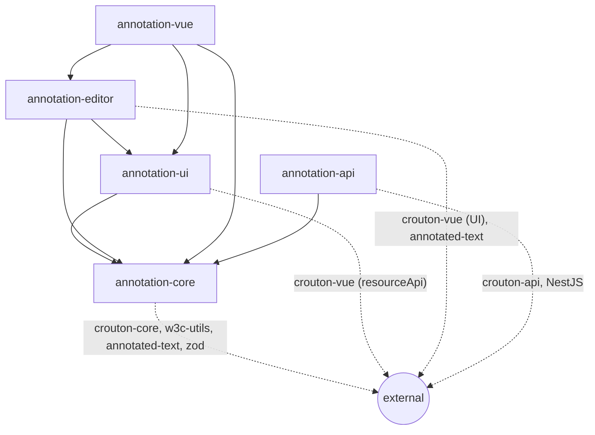

# Architecture

How the monorepo is put together. Read this before changing code; read the [guide](/guide/quick-start.md) for how
to *use* the packages.

- [Frontend](./frontend.md) — `SmartAnnotationEditor` → `AnnotationEditor` → `SourceEdit`, state, events, modals.
- [Backend](./backend.md) — `AnnotationApiModule`, endpoints, the repository/mapper contract.

## Packages

| Package                       | Published | Role                                                                                     |
|-------------------------------|-----------|------------------------------------------------------------------------------------------|
| `@ghentcdh/annotation-core`   | yes       | Framework-free types + Zod schemas: resource JSON, `SourceModel`, JSON-LD context, grid layout, style builder. |
| `@ghentcdh/annotation-ui`     | no        | Framework-light glue shared by the Vue packages: `EditorAnnotation`, `AnnotationTransformer`, W3C transformer, `UIAnnotationDefinition`, annotated-text configuration. |
| `@ghentcdh/annotation-editor` | no        | The `AnnotationEditor` Vue component: renders sources, handles create/edit/delete/link through modals. Knows nothing about loading data. |
| `@ghentcdh/annotation-vue`    | yes       | What apps install. Bundles `ui` + `editor`, adds `SmartAnnotationEditor` (loading, filtering, errors), definition loading, status page routes. Re-exports `core` and `editor`. |
| `@ghentcdh/annotation-api`    | yes       | NestJS dynamic module serving definitions (via crouton) and an optional W3C annotation CRUD API. |
| `docs`                        | —         | This VuePress site. Aliases package imports to `src/` (see `docs/.vuepress/config.ts`). |

`annotation-ui` and `annotation-editor` are `private`: they are bundled into `annotation-vue` at build time
(`tools/vite/*`), so consumers never install them. Their versions do not matter.

## Dependency graph

Rules:

- `core` imports no Vue and no NestJS. Anything shared by front- and backend goes here.
- `api` never imports a Vue package.
- `editor` never loads data. It receives `sources`, `annotations`, `annotationDefinitions` as props and emits events;
  persistence goes through `definition.resource` (a crouton `resourceApi` client built in `ui`).
- Apps depend on `annotation-vue` only — never on `annotation-ui` / `annotation-editor`.

Boundaries are enforced by `@nx/enforce-module-boundaries` (`eslint.config.mjs`).

## Key external libraries

| Library                       | Used for                                                                    |
|-------------------------------|-----------------------------------------------------------------------------|
| `@ghentcdh/annotated-text`    | Renders text + highlights; `TextAdapter`, `AnnotationAdapterParams`.        |
| `@ghentcdh/crouton-*`         | Resource JSON format, schema → form/table compilation, REST resources, UI components (`Drawer`, `Collapse`, `Loading`, `NotificationService`). |
| `@ghentcdh/w3c-utils`         | `W3CAnnotation` type + builder used by the W3C transformer and the API mapper. |
| `zod@4`                       | Every external shape is parsed at the boundary.                              |

## Domain glossary

| Term                         | Meaning                                                                                       |
|------------------------------|-----------------------------------------------------------------------------------------------|
| Resource JSON                | Crouton JSON file describing one annotation type (fields, views, operations). Extended with an `annotation` block (`AnnotationConfigSchema`). Its `name` is the type id. |
| Annotation definition        | A parsed resource JSON. `UIAnnotationDefinition` = definition + compiled form/table schema + `resource` client + `canCreate`/`canEdit`. |
| Source / `SourceModel`       | A text to annotate: `uri`, `id`, `content` (text, label, `textDirection`).                    |
| `EditorAnnotation`           | The editor's internal annotation shape: `id`, `definitionUri`, `selectors`, `links`, `metadata`, `parentId`. |
| `AnnotationTransformer<T>`   | `parse(T) → EditorAnnotation` and `format(EditorAnnotation) → T`. Lets apps store any model. `w3cAnnotationTransformer` is the default. |
| Selector                     | Text position (`start`, `end`, source `uri`) of an annotation.                                |
| Link annotation              | A definition with `annotation.type === 'link'`; connects other annotations instead of text.   |
| `SCHEMA_PREFIX`              | `annotation-editor` — URL prefix of every API route.                                          |

## Build & release

- Each package: Vite library build + `vite-plugin-dts`. `annotation-vue` inlines `ui`/`editor` and their `.d.ts`
  (`tools/vite/bundle-dts-imports.mts`, checked by `check-dts-imports.mts`).
- Published `package.json` is rewritten into `dist/` (`tools/vite/copy-package-json.mts`).
- CI: `.github/workflows/merge-request.yml` → crouton's shared CI (lint, typecheck, test, build, knip).
- Release: `nx release` (see `CONTRIBUTING.md`). Maintainers cut releases; contributors only open PRs.
