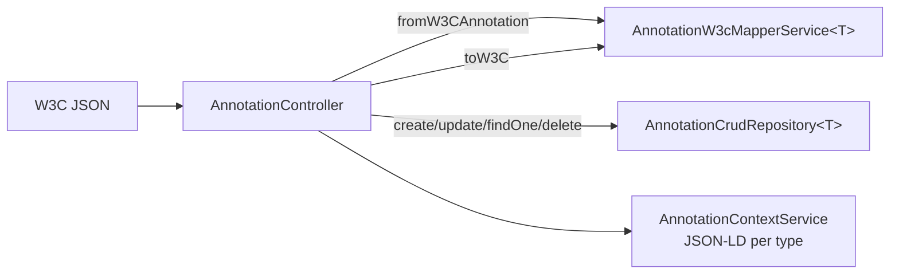

# Backend

`@ghentcdh/annotation-api` is a NestJS dynamic module on top of `@ghentcdh/crouton-api`. Usage: see
[Backend integration](../guide/backend-integration.md). Paths below are relative to `packages/annotation-api/src/lib/`.

## Module wiring

`AnnotationApiModule.forResourceDir(resourcePath, datasourcePath, config, annotation?)`
(`annotation-api.module.ts`):

1. `resolveConfig(config)` (from core) fills defaults (`baseUrl`, …).
2. Registers the `annotation` resource-JSON extension (`AnnotationConfigSchema`) with crouton — at import time
   *and* in the crouton options.
3. Imports `CroutonApiModule.forResourceDir(...)` with `prefix: SCHEMA_PREFIX` and a schema enricher
   (`utils/schemaEnricher.utils.ts`) that adds the JSON-LD context to every schema.
4. Always: `AnnotationNamespaceController`, `AnnotationContextService`, config under `ANNOTATION_DEF_CONFIG_TOKEN`.
5. Only when `annotation` (repository + mapper) is passed: `AnnotationController` and the two abstract-class
   providers bound with `useExisting`.

The module is `global: true`.

## Endpoints

All prefixed with `SCHEMA_PREFIX` = `annotation-editor` unless noted.

| Route                                    | From                        | Purpose                                  |
|------------------------------------------|-----------------------------|------------------------------------------|
| crouton resource routes (`/<prefix>/<name>/schemas`, CRUD) | `CroutonApiModule` | Definitions + generic resource CRUD.    |
| `GET /ns`                                | `AnnotationNamespaceController` | List annotation types with schema + JSON-LD links. Uses `API_URL` env. |
| `GET /ns/:id.jsonld`                     | `AnnotationNamespaceController` | JSON-LD context for one type.        |
| `POST /<prefix>/annotation/:type`        | `AnnotationController`      | Create from a W3C annotation body.       |
| `GET /<prefix>/annotation/:type/:id`     | `AnnotationController`      | Read as W3C.                             |
| `GET /<prefix>/annotation/:id`           | `AnnotationController`      | Read as W3C, type resolved by repository. |
| `PATCH /<prefix>/annotation/:type/:id`   | `AnnotationController`      | Update.                                  |
| `DELETE /<prefix>/annotation/:id` and `/:type/:id` | `AnnotationController` | Delete.                         |

## Contract for apps

- `annotation/annotation.repository.ts` — abstract `AnnotationCrudRepository<T>`: `create`, `update`, `delete`,
  `findOne(id) → { annotation, type }`.
- `annotation/annotation.mapper.service.ts` — abstract `AnnotationW3cMapperService<T>`: implement
  `mapToW3CAnnotation` / `mapFromW3CAnnotation`.
- `context/annotation-context.service.ts` — builds the JSON-LD context for each registered resource with
  `createAnnotationContext` from `@ghentcdh/annotation-core`.

Storage is entirely the app's concern; this package has no database code.

## Shared with the frontend

Everything both sides must agree on lives in `annotation-core`:

- `AnnotationConfigSchema` / `AnnotationJsonResourceSchema` — the resource JSON format.
- `CURRENT_RESOURCE_VERSION` — resource JSON versioning (`types/version.ts`).
- JSON-LD context builders.
