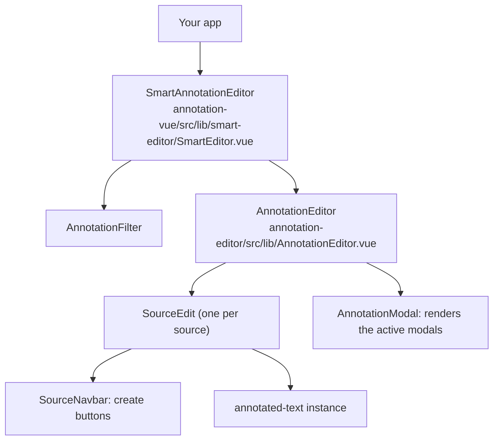
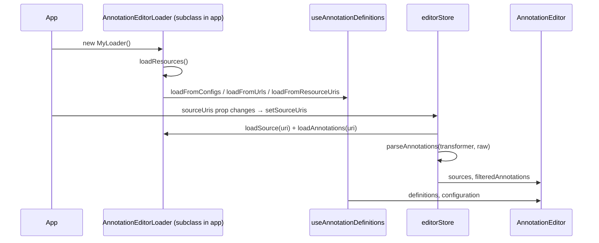
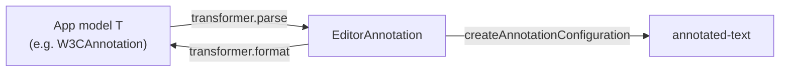

# Frontend

Paths are relative to `packages/`.

## Component tree

| Layer                    | Owns                                                                     | Does not own              |
|--------------------------|--------------------------------------------------------------------------|---------------------------|
| `SmartAnnotationEditor`  | Loading sources + annotations (via an `AnnotationEditorLoader`), filter state, load errors + retry, syncing selection to the route query. | Rendering text, modals.   |
| `AnnotationEditor`       | Editor state, modal stack, annotation events, grid layout.               | Fetching anything.        |
| `SourceEdit`             | One annotated-text instance bound to one source.                         | Saving.                   |

You can use `AnnotationEditor` without the smart wrapper if your app already has the data
(see [guide](../guide/annotation-editor.md)).

## Loading (annotation-vue)

- `AnnotationEditorLoader<T>` (`smart-editor/AnnotationEditorLoader.ts`) is the app's extension point: implement
  `loadResources`, `loadSource`, `loadAnnotations`. Must be constructed inside `setup()` (it calls `inject`).
- Definitions state is provided once (`provideAnnotationDefinitions`) and injected everywhere
  (`definitions/useAnnotationDefinitions.ts`).
- `editorStore.ts` uses sequence counters (`sourcesSeq`, `annotationsSeq`) so stale responses are dropped.
- After create/update/delete the editor emits and `SmartAnnotationEditor` calls `store.reload` — the server is the
  source of truth; there is no optimistic local update.
- Errors from any loader are normalised by `toEditorLoadError` and rendered by `SmartEditorError` (or the `#error`
  slot).

## Editor state (annotation-editor)

`useProvideEditorState` (`composables/useEditorState.ts`) runs once in `AnnotationEditor` and `provide`s:

| Field                | What                                                                          |
|----------------------|-------------------------------------------------------------------------------|
| `config.modal`       | Typed modal stack (see below).                                                |
| `config.createAnnotatedText` | Factory for annotated-text instances; rebuilt when adapter, transformer or definitions change. |
| `editorState`        | `editorState` (`'show' \| 'create' \| 'edit' \| …`), `selectedAnnotation`, `disableEdits`, `readonly`, `format`, `transformMetadata`. |
| `sendAnnotationEvent`| Single entry point for user actions.                                          |
| `getDefinition`, `findAnnotation`, `annotations`, `sources` | Lookups.                         |

Children call `useEditorState()` (throws outside an editor). Each editor instance has isolated state.

## Annotation events

All user actions go through `sendAnnotationEvent(event, data)` in `composables/annotation.events.ts`:

| Event    | Handler            | Effect                                                                                       |
|----------|--------------------|----------------------------------------------------------------------------------------------|
| `create` | `createAnnotation` | Opens `edit-annotation` with a draft (`id: ''`). On close emits `create:annotation`.          |
| `edit`   | `editAnnotation`   | Opens `edit-annotation` or `link-annotation` (link types). On close emits `update:annotation`. |
| `delete` | `deleteAnnotation` | Opens `confirm`, deletes via `definition.resource`, emits `delete:annotation`.                |
| `select` | `handleSelectAnnotation` | Opens `info-card`, emits `select:annotation`. Also ends an in-progress link.          |
| `link`   | `startLinking`     | Enters linking mode; the next `select` completes the link (`endLink`).                        |

`disableEdits` guards against starting a second action while a modal is open.

Persisting happens inside the modal (`composables/useAnnotationResource.ts`): `editorState.format()` turns the
`EditorAnnotation` back into the app model, then `definition.resource.create/save` calls the crouton REST
resource. `canCreate` / `canEdit` come from the resource JSON `operations`.

## Modal machinery

Modals are typed by key. Adding one touches three places:

1. `modals/<name>/` — `X.vue`, `X.properties.ts` (data / show / close-event types), `useX.ts` (a class or
   function returning `AnnotationModalFn`).
2. `modals/AnnotationModal.defaults.ts` — add the key to `AnnotationModalActionMap` (types) and
   `annotationModalDefaults` (component + `useFn`).
3. Call it: `config.modal.show('<key>', data)` returns a `Promise<closeEvent | null>`.

Types live in `modals/AnnotationModal.definition.ts`; the stack in `modals/createModalConfig.ts`;
`AnnotationModal.vue` renders whatever is open. `open-modal.ts` handles opening by id from props
(`selectedAnnotationId` / `selectedAnnotationAction`).

Current keys: `info-card`, `edit-annotation`, `link-annotation`, `confirm`, `toast`.

## Annotation model & transformers (annotation-ui)

- `adapter/editor.annotation.ts` — `editorAnnotationSchema` (Zod) is the contract.
- `adapter/transform.annotation.adapter.ts` — `AnnotationTransformer<T>`, `parseAnnotations` (drops what
  `parse` returns `null` for), `createLinks`.
- `adapter/w3c.transform.annotation.adapter.ts` — `w3cAnnotationTransformer`, the default.
- `annotated-text/annotation-configuration.factory.ts` — maps definitions to annotated-text styles.
- `types/ui-annotation-definition.type.ts` — `UiAnnotationDefinitionSchema` turns a definition into a
  `UIAnnotationDefinition` (label = `title ?? name`, `resource` client, permissions).

## Where to change what

| Task                                       | Start in                                                      |
|--------------------------------------------|---------------------------------------------------------------|
| New user action on an annotation           | `annotation-editor/src/lib/composables/annotation.events.ts`  |
| New modal                                  | `annotation-editor/src/lib/modals/AnnotationModal.defaults.ts` |
| How annotations are highlighted            | `annotation-ui/src/lib/annotated-text/`, `annotation-core/src/lib/annotation.style.ts` |
| Support a new storage model                | Write an `AnnotationTransformer<T>` in the app; no library change. |
| New field in resource JSON `annotation` block | `annotation-core/src/lib/types/annotation-json-config.types.ts` (shared by API + UI) |
| Loading / error / retry behaviour          | `annotation-vue/src/lib/smart-editor/`                         |
| Definition loading strategies              | `annotation-vue/src/lib/definitions/`                          |
